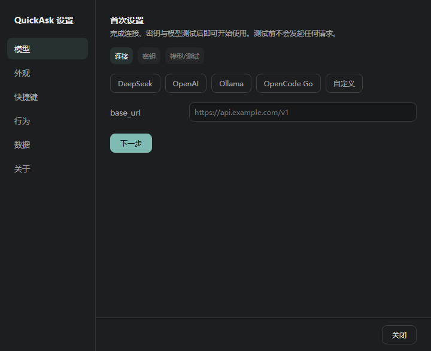

# QuickAsk

> QuickAsk is a local-first desktop AI command bar for Linux (X11) and Windows 10/11.
> Press a global hotkey, ask once, press Esc — conversations stay in local SQLite.
> Linux keeps native X11 shape/blur; Windows uses a documented degraded click-through mode.

QuickAsk 是一个常驻系统托盘、按全局热键唤起的极简桌面问答条：按一下键就能问，
按 `Esc` 就走，答案和历史全部留在本地。它不是桌面版 ChatGPT，而是给 AI 加一个
Spotlight。

技术栈：Electron 45 + React 19 + TypeScript + SQLite（`node:sqlite`）/ FTS5。
Linux 使用 Xlib/Xext 原生 helper 做精确点击区域与毛玻璃；Windows 使用 Electron
原生能力，并对降级项如实标注。

<p align="center">
  
</p>

## 截图

Windows 10 实机上的真实运行画面（VirtualBox 虚拟机 1600×913，未做美化）：




> 截图环境：Windows 10 x64 / Electron 45.2.2。Windows 侧的降级项——点击穿透为整窗切换、
> 无毛玻璃、字体为固定候选——在「设置 → 关于 → 平台能力」里同样如实标注，不做伪装。

## 平台支持

| 平台 | 状态 | 说明 |
|---|---|---|
| Linux X11（KDE Plasma 已实测） | 可用 | 精确 `ShapeInput`/`ShapeBounding` 点击穿透；毛玻璃取决于 KWin 是否开启 |
| Windows 10/11 x64 | 可用（部分降级） | 点击穿透为整窗切换（约 50ms），无毛玻璃，无看门狗，字体为固定候选；**真机验收清单见 [docs/WINDOWS.md](docs/WINDOWS.md)** |
| Linux Wayland | 不支持 | 需要 X11 会话；应用固定使用 `ozone-platform=x11` |
| macOS | 未适配 | 平台层会诚实报告 `unsupported`，不会假装可用 |

三态约定：`available`（可用）、`degraded`（可用但降级，UI 标注“受限”并给出原因）、
`unsupported`（不支持，UI 标注“不支持”并给出原因）。能力矩阵通过 `app:bootstrap`
的 `platformCapabilities` 暴露。

## 功能

- **一键唤起**：全局热键 `Control+Alt+Space`；冲突时自动尝试备选键并提示，可重试恢复主键。
- **常驻托盘**：托盘左键切换显示/隐藏，右键菜单包含新建会话、历史、设置、退出；单实例运行。
- **极简输入**：1–6 行自增高胶囊条，`Enter` 发送 / `Shift+Enter` 换行；输入法组合期不误发。
- **本地历史**：SQLite 持久化、自动标题、全文搜索（FTS5 trigram + LIKE 回退）、重命名、删除确认。
- **流式回答**：SSE 流式渲染、Markdown/代码高亮/表格/链接、停止并保留已生成内容、重新生成。
- **图片输入**：最多粘贴 4 张截图，压缩后随消息入库；纯文字消息不会携带图片字段。
- **多轮上下文**：同一会话携带历史，超预算按“保留最近轮”策略裁剪。
- **本地优先**：零遥测、零自动外联；API key 只进系统钥匙串或 `safeStorage` 加密回退。
- **设置**：模型、外观、快捷键、行为、数据、关于六组；能力状态如实展示。

## 安装

### Windows 10/11

需要 Node.js ≥ 24 才能从源码构建；最终用户只需要产物：

```powershell
npm ci
npm run typecheck
npm test
npm run dist:win
```

产物：

- `release/win-unpacked/quickask.exe`：免安装目录版
- `release/QuickAsk-<version>-setup.exe`：NSIS 安装包
- `release/QuickAsk-<version>-portable.exe`：便携版

未签名产物会触发 SmartScreen 提示；公开发布前应配置代码签名。Windows 上不需要
gcc 或 Visual Studio，`@napi-rs/keyring` 使用预编译二进制。

### Linux

Debian/Ubuntu 构建依赖：

```bash
sudo apt install -y build-essential libx11-dev libxext-dev desktop-file-utils
```

```bash
npm ci
npm run build
npm run dist:deb     # release/quickask_<version>_amd64.deb
# 或
npm run dist:dir     # release/linux-unpacked/
./release/linux-unpacked/quickask
```

`.deb` 安装、密钥环、自启动与卸载步骤见 [INSTALL.md](INSTALL.md)。

## 从源码开发

```bash
git clone https://github.com/ragn-xt12114/quick-ask.git
cd quick-ask
npm ci

# Linux 首次需要编译 X11 helper
npm run build:native

npm run dev          # electron-vite dev
npm run build        # 生成 out/
npm start            # electron-vite preview
```

Node.js ≥ 24（`package.json` engines）。Linux 的 `npm run build:native` 需要
`gcc` + `libx11-dev` + `libxext-dev`；Windows 上该命令会打印跳过日志并 `exit 0`，
不会尝试调用 gcc/bash。

常用脚本：

| 命令 | 作用 |
|---|---|
| `npm run typecheck` | 主进程 + 渲染层 TypeScript 检查 |
| `npm run lint` | ESLint（含 `process.platform` 只能在 `src/main/platform/` 的规则） |
| `npm test` | Vitest 单元 + 集成测试 |
| `npm run build` | electron-vite 生产构建 |
| `npm run build:native` | Linux X11 helper（其他平台跳过） |
| `npm run dist:dir` | 当前平台目录包 |
| `npm run dist:deb` | Linux `.deb` |
| `npm run dist:win` | Windows NSIS + portable |
| `npm run test:e2e` | Playwright + Electron（需要 X11） |

### e2e

```bash
DISPLAY=:0 npx playwright test
```

前置：真实 X11 会话（`DISPLAY=:0`）、`xdotool`、`xprop`、`xmessage`、`xev`，
以及已编译的 `native/quickask-x11`。运行前请确保焦点不在会抓取键盘的虚拟机窗口
（VirtualBox/VMware 等），否则 XTest 全局热键事件会被吞掉，造成假失败。

像素对比用例还需要 Python 3 + Pillow；如果它不在默认 `python3`，先导出
`PYTHON=/path/to/python`。

CI（`.github/workflows/ci.yml`）只跑 `typecheck` / `lint` / `test` / `build`，
**不跑 e2e**（CI 无 X11）。

## 数据、配置与隐私

| 内容 | Linux | Windows |
|---|---|---|
| 配置 | `${XDG_CONFIG_HOME:-~/.config}/quickask` | `%APPDATA%\QuickAsk` |
| 数据库 | `${XDG_DATA_HOME:-~/.local/share}/quickask/quickask.db` | `%LOCALAPPDATA%\QuickAsk\quickask.db` |
| 日志 | `${XDG_STATE_HOME:-~/.local/state}/quickask/logs` | `%LOCALAPPDATA%\QuickAsk\logs` |
| 崩溃转储 | `<配置目录>/Crashpad` | `%LOCALAPPDATA%\QuickAsk\Crashpad` |
| 自启动 | `${XDG_CONFIG_HOME:-~/.config}/autostart/quickask.desktop` | `HKCU\Software\Microsoft\Windows\CurrentVersion\Run\QuickAsk` |

`QUICKASK_DATA_DIR` 可覆盖数据库目录（两端通用）。

- API key 与额外请求头只存系统凭据（Linux Secret Service/KWallet；Windows Credential
  Manager）或 `safeStorage` 加密回退；数据库、配置、日志中没有明文 key。
- 零遥测、零自动更新检查、零崩溃上报；渲染层 CSP `connect-src 'none'`，网络请求只由
  主进程发往用户配置的 endpoint。
- 日志脱敏（Authorization/token/api_key 等），错误详情截断 300 字。
- 历史仅写入本地 SQLite，不会自动上传或删除。

## 已知限制

- 仅支持 Linux X11 与 Windows 10/11 x64；Wayland、macOS 未适配。
- Windows 点击穿透为整窗 `setIgnoreMouseEvents` 切换，透明边距可能有约 50ms 延迟。
- Windows 不支持毛玻璃：Win10 无 acrylic，Win11 的 Mica/`backgroundMaterial` 不能
  跨版本使用；应用显示“不支持”并使用半透明纯色卡片。
- Windows 看门狗守护不可用（脚本是 Bash + `flock`）；自启动走 HKCU 登录项。
- Windows 字体只提供 Microsoft YaHei UI / Segoe UI / Consolas / Cascadia Mono 固定候选。
- Windows 产物未签名；未做自动更新、ARM64、安装包实机验收。
- Windows 真机验证尚未执行；当前状态是“可构建 + 代码路径有单测 + 交叉打包通过”，
  不是“已实机验收”。清单见 [docs/WINDOWS.md](docs/WINDOWS.md)。
- Windows 中文输入法组合期行为未在实机验证；Linux fcitx5 有宿主相关已知行为。

## 目录结构

```text
src/
  main/
    platform/        # 平台适配器：linux / win32 / noop / 路径
    window/          # 窗口、布局应用、X11 helper、合成器探测
    startup/         # XDG .desktop 与 Windows 登录项
    ipc/             # 类型化 IPC 路由与 handler
    db/              # SQLite schema、迁移、仓储
    provider/        # OpenAI 兼容 SSE、代理、脱敏
    secrets/         # keyring + safeStorage
    ...
  renderer/          # React UI（主窗口 + 设置窗口）
  shared/            # IPC 线协议、平台能力类型、纯函数
native/
  quickask-x11.c     # Linux X11 helper（Shape/Blur/WM_CLASS）
tests/
  unit/ integration/ # Vitest
  e2e/ visual/       # Playwright + Electron（X11）
docs/                # 设计草图、spike/验收笔记、WINDOWS.md
scripts/             # 构建与本地环境脚本
```

## 设计文档

`docs/` 中保留了 M0/M1 的设计草图、spike 报告和验收笔记，作为架构与取舍依据。
其中引用的 `.omo/` 证据目录是私有开发存档，**不在本仓库中**；相关链接仅作历史说明。

Windows 专项说明见 [docs/WINDOWS.md](docs/WINDOWS.md)，贡献指南见
[CONTRIBUTING.md](CONTRIBUTING.md)。

## License

[MIT](LICENSE) © 2026 ragn-xt12114
